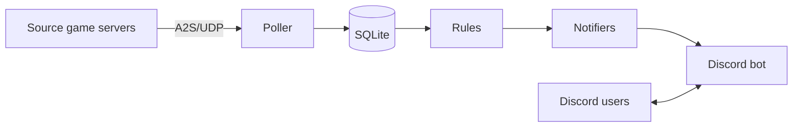

# sourcewatch

How the system is built. `DECISIONS.md` overrules this file wherever they disagree. Cite decision codes (`B2`) instead of restating the choice or its reason.



## A. Purpose and scope

Track players on Source game servers and notify people when something they care about happens (a server fills up, a map changes, a server goes offline).

**Goals**
- Live counts straight from the servers (B1).
- Per-user opt-in notifications (E2).
- A channel status board.

**Non-goals**
- Notification channels other than Discord (E2).
- Player identity beyond A2S names for v1 (B4, G1).

## B. Context

| Actor / external system | Direction | Interface |
|---|---|---|
| Source game servers | out | A2S over UDP (`A2S_INFO`, `A2S_PLAYER`) |
| Discord users | both | Slash commands, DMs, gateway WebSocket (E1) |

## C. Components

```
poller ──A2S/UDP──> game servers
   │
   ├── store (SQLite): servers, last state, notifications, cooldowns
   │
   └── notifiers ──> Discord bot (/notify: channel or DM)
```

| Component | Responsibility | Depends on | Owns (data/state) |
|---|---|---|---|
| Poller | Queries each server every 60 s with jitter (B3). At startup the first polls are spread over one interval. `A2S_INFO` always, `A2S_PLAYER` only when players > 0. Challenge handshake per query, 2 s timeout, 2 retries, offline after 3 failed cycles. Bots filtered from counts. | A2S client (B2) | Nothing persistent |
| Store | Server list, last known state per server, notifications, per-user cooldowns. | SQLite | All persistent state |
| Rules | Compares new state with last state and notifications. A matching rule out of its 5 s cooldown produces an event (C1, C2, C4). | Store | Nothing |
| Notifiers | One interface, `Send(target, title, message)`. Providers are plugins. | Rules | Nothing |
| Discord notifier | Sends a fired notification over Discord REST: in the channel `/notify` was run in (default) or by DM (E6). Mentions the player by Discord ID and always sets `allowed_mentions` with only that ID (D2). Honours `retry_after` on 429, stops on 401. A refused DM or channel marks the notification undeliverable (E7, D4). | `discordgo` | Nothing |
| Bot | Slash command `/notify` (conditions: map, player, playercount, status, title-query; C1) and its management commands (C6). A Discord server sets the target game server and its players use `/notify` against it (C6). | `discordgo` (A5) | Nothing |

## D. Key flows

**Poll and notify**
1. Poller → game server: `A2S_INFO`, then `A2S_PLAYER` if players > 0.
2. Poller → Store: load last state, save new state.
3. Rules → Store: match the change against notifications and cooldowns.
4. Rules → Notifiers: send each resulting event.

**Create a notification**
1. Player → Bot: `/notify` with conditions (C1), in a Discord server that has a target game server (C6).
2. Bot → Store: save notification.

## E. Data

| Entity | Fields that matter | Stored in | Lifetime |
|---|---|---|---|
| Server | address, name | SQLite / config (E3) | Until removed |
| Last state | players, map, online | SQLite | Latest, overwritten each poll |
| History | changes in players, map, status; player sessions | SQLite | Accumulative, queryable by `/notify` (C3, C5) |
| Notification | user, conditions | SQLite | Until removed (C6) |
| Cooldown | user, rule, last fired | SQLite | 5 s (C2) |

## F. Interfaces and contracts

| Interface | Kind | Spec location |
|---|---|---|
| `Notifier.Send(target, title, message)` | Go interface | To be created in Phase D |
| `/notify` | Discord | `ROADMAP.md` Phase E |

## G. Stack

| Need | Choice | Decision |
|---|---|---|
| Language | Go, self-hosted single static binary. One goroutine per server with its own ticker plus jitter, timeouts via `context` and connection deadlines, cross-compiles easily. | A1 |
| Discord bot | `discordgo`, gateway mode. Check recent release activity before committing. | A5, E1 |
| A2S client | Hand-written on `net` UDP (~100 lines: request, challenge, parse), or a maintained community package | B2 |
| Store | SQLite via `modernc.org/sqlite` (pure Go, no cgo) | C3 |
| Config and logging | Standard library: env vars or a `600` config file, `log/slog` | A2 |
| Framework | None. `main()` starts the poller goroutines and the bot together. | A1 |

## H. Quality targets

| Attribute | Target | How checked |
|---|---|---|
| Mention safety | Player names never ping | Test on `allowed_mentions` (D2) |
| Secrets | None in the repo | Review; secret scan in CI |
| Portability | Static binary, no cgo | `CGO_ENABLED=0 go build` |

## I. Constraints

- Runs on a Debian server (A3).
- No public IP, domain, TLS or port forwarding: the gateway is an outbound WebSocket (E1).
- The bot token lives in environment variables or a `600` config file (A2).
- DMs are opt-in only, to avoid Discord's spam restrictions (A4, E2).
- A2S names can be spoofed. Treat them as a display hint, not an identity (B4).

## J. Repository layout

```
README.md  the guide for people using the bot
assets/    logo.png, logo.svg
scripts/   check_dlad.py (validates DECISIONS.md and ROADMAP.md)
docs/      discord-guide.md (the guide to paste into a Discord channel, in messages under 2000 characters)
cmd/       sourcewatch/main.go (starts the poller and the bot together)
internal/  app, bot, config, notify, poller, rules, store (one package per component of section C)
deploy/    sourcewatch.service (the systemd unit, A3)
.github/   workflows/ci.yml (format, vet, static build, race tests, Debian run, README install under systemd,
           docs check, govulncheck, gitleaks), workflows/release.yml (static Linux binaries for each v* tag)
```
