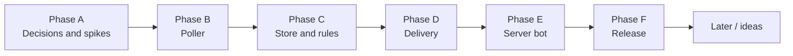

# Roadmap

Planned work, in order. `DECISIONS.md` overrules this file wherever they disagree. Phases are lettered (Phase A, Phase B, and so on) and match decision codes. A phase starts only when its decisions are Decided.

Keep the diagram in sync with the phase headings below: one node per phase, in order.

**Task format:** `- [ ] <task> (<codes>). Done when: <check>`
- Codes are the decisions the task depends on.
- The check is something the agent can run or observe: a command, a test, a visible behavior.
- A task fits one session and one reviewable diff. If it doesn't, split it.
- Tasks run top to bottom. `[P]` after the checkbox marks a task that can run in parallel with its neighbors because it touches different files.

## Phase A: Decisions and spikes

**Goal:** settle what blocks Phase B.
**Exit:** every A and B row in `DECISIONS.md` is Decided.

- [x] Check `discordgo` release activity and slash command support (A5). Done when: findings are recorded in the A5 row.
- [x] [P] Compare a hand-written A2S client with community packages (B2). Done when: options and evidence are recorded in the B2 row.
- [x] Scaffold the Go module, config loading (env vars or `600` file) and `log/slog` logging (A1, A2). Done when: `go build ./...` and `go test ./...` pass and the binary logs its loaded config with secrets redacted.

## Phase B: Poller

**Goal:** the program polls configured servers over A2S and logs their state.
**Exit:** run against a real Source server, it logs players, map and online/offline transitions.
**Out of scope:** persistence, notifications.

- [x] A2S client on `net` UDP: `A2S_INFO`, `A2S_PLAYER`, challenge handshake (B1, B2). Done when: unit tests against a fake UDP server cover the handshake, a valid reply and a malformed reply.
- [x] 2 s timeout, 2 retries, offline after 3 failed cycles (B1). Done when: tests cover timeout, retry and the offline transition.
- [x] One goroutine per server, 60 s ticker with jitter (B3). Done when: a test shows intervals fall within 60 s ±5 s and that cancelling the context stops all goroutines.
- [x] `A2S_PLAYER` only when players > 0, bots filtered from counts (B1, B4). Done when: a test shows no player query for an empty server and bots excluded from the count.
- [x] Server list from config (B1). Done when: a test loads a config with two servers and polls both.

- [x] GameTracker page parser: status, name, map, player count, player names and the scan age (B5). Done when: tests on a saved page cover alive, not alive, a missing Status field (offline), another server's page, and unparsable pages.
- [x] Fallback in the poller: ask GameTracker for a server A2S cannot reach, at most every 5 minutes, using only newer scans under 20 minutes old (B5). Done when: tests cover alive, not alive, stale, fetch errors, an unchanged scan, and A2S recovering.
- [x] `/status` says when data came from GameTracker and how old it is (B5, D3). Done when: a handler test shows "Via GameTracker, scanned N min ago".
- [x] Live check: against a server A2S cannot reach, the fallback reports it from the real page. Done when: the service log on the deployed host shows the server online through GameTracker.

## Phase C: Store and rules

**Goal:** state changes become events, deduplicated by cooldowns.
**Exit:** a test feeds a sequence of states and gets exactly the expected events.
**Out of scope:** delivering events.

- [x] SQLite schema (`modernc.org/sqlite`): servers, last state, history, notifications, cooldowns (C3, C5). Done when: a migration test creates the schema on an empty database.
- [x] Persist the last known state per server and record history only when something changes: map, player sessions, server title and status (C3, C5). Done when: a restart test shows the last state is reloaded, and a test shows an unchanged poll adds no history row.
- [x] Diff new state against the last state and produce events for the `/notify` conditions `map`, `player`, `playercount` (a comparison in the value; a plain number means at least, up to 64), `status` and `title-query` (C1, C4). Done when: table-driven tests cover each condition, each playercount operator and the no-change case.
- [x] `playercount` fires once when its condition becomes true, rearms when it stops being true, and does not fire again within a configurable cooldown, default 60 minutes (C7). Done when: tests show one event for a sustained condition, none inside the cooldown, and a new event after it clears, rearms and the cooldown has passed.
- [x] Suggest similar `player` and `map` values from history when there is no exact match (C5, C7). Done when: tests show exact match first, then prefix, substring and near-miss typos (for example `dust` and `de_dust` suggest `de_dust2`), and an empty list when nothing is similar.
- [x] Per-user cooldowns of 5 seconds (C2). Done when: a test shows a second matching event inside 5 s is suppressed and one after 5 s is delivered.
- [x] An event held back by the per-user cooldown is not saved as fired, so it fires at the next poll (C2, C9). Done when: store tests show two notifications of one user firing in the same poll delivered one poll apart, and the same for a notification for all servers firing on two servers within 5 s.

## Phase D: Delivery

**Goal:** a fired notification reaches the player, in a channel or by DM.
**Exit:** against a test Discord server, a channel notification posts mentioning only that player by ID, and a DM notification arrives as a DM.
**Out of scope:** the `/notify` command itself and the status command.

- [x] `Notifier` interface: `Send(target, title, message)` (D1). Done when: a fake notifier satisfies the interface in a test.
- [x] Discord REST notifier, channel (default) and DM (D1, E6). Done when: `httptest` tests show a channel notification sends to the given channel, and a DM one creates a DM channel and sends to it.
- [x] Mention the player by Discord ID and always set `allowed_mentions` with `parse` empty and only that ID (D2). Done when: a test shows the message contains `<@id>`, and that a player name containing `@everyone` is sent as plain text with no ping allowed.
- [x] Handle closed DMs (error `50007`) for DM notifications (E7). Done when: a test with a stubbed 50007 response follows the E7 decision.
- [x] Honour `retry_after` on 429 and stop on 401 (D1). Done when: `httptest` tests cover the 429 wait and the 401 stop.
- [x] A channel notification that Discord refuses (unknown channel, missing access or permissions) is marked undeliverable and the user is told (D4, E7). Done when: notifier tests map errors 10003, 50001 and 50013, a delivery test marks every notification of a refused channel message, and a handler test shows the notice with the channel reason.

## Phase E: Server bot

**Goal:** a Discord server or a single user picks game servers to watch and sets up notifications with slash commands.
**Exit:** in a test guild, a target game server is set and a player's `/notify` fires a message when its condition is met.
**Out of scope:** Steam ID checks (G1).

- [x] Gateway bot connection (E1, A5). Done when: the bot comes online in a test guild.
- [x] The poller adds and removes game servers at runtime, and polls a server only while someone listens to it (E3, E4). Done when: a test adds a server, sees it polled, removes the last listener and sees polling stop.
- [x] `/server add` in a Discord server sets its target game server (C6, E3, E9). Done when: a handler test stores the target for a guild, and a user without the Manage Server permission is refused.
- [x] `/server add` and `/server remove` in a DM with the bot, for several servers (E4). Done when: handler tests add two servers, remove one, and the other keeps being polled.
- [x] `/notify map`, `player`, `playercount`, `status` and `title-query` with the id and server options; without a server it applies to all (C1, C4, C6, C7, E6, E9, E11). Done when: each condition is registered, a handler test creates a notification for the target with channel as the default delivery, and with two targets available the handler asks which server before creating it.
- [x] Deliver a player's notification when it fires, in the channel `/notify` was run in by default, or by DM when chosen (E6). Done when: handler tests create one notification with each option and check the delivery target.
- [x] `/notify list` (E5). Done when: a handler test lists a user's notifications.
- [x] `/help` lists all commands (E5). Done when: a test checks that every registered command appears in the help text.
- [x] `/status` shows every game server with who is online, with no options, and the reply is public (D3, E8). Done when: handler tests show each server with its own players under it, that the command has no options, that its reply is not ephemeral while every other command's is, and that it stays under Discord's length limit.
- [x] `/notify remove` removes one notification (E8). Done when: a handler test removes a user's notification.
- [x] `/notify reset` deletes all of a user's notifications here, after asking with buttons (E13). Done when: handler tests show the question first, that confirming deletes only that user's notifications in that place, and that cancelling deletes nothing.
- [x] `/notify settings` shows or changes the cooldown, on/off and delivery of one notification, or of all of them with `all` (E14). Done when: handler and store tests cover each setting, that a disabled notification never fires, that enabling starts it over, that a DM is tested first, and that only the owner can change it.
- [x] One notification for all servers, listed under "All servers", with its state kept for each game server (E9). Done when: store and handler tests show it fires on each server independently, covers servers added later, and stops for a removed one.
- [x] `/notify show` shares the list with the channel (E11). Done when: a test shows its reply is public, carries no private notices, and cannot ping.
- [x] `/admin settings`: channel delivery, default delivery, default cooldown, active, and the player blacklist (E15). Done when: tests cover permission, each setting, that the off switch blocks every command but `/admin`, and the blacklist in creation, delivery and `/status`.
- [x] People with the same notification in the same channel are mentioned together in one message (E16). Done when: delivery tests show one message mentioning everyone once, separate messages for different text or channels, no merging of DMs, and splitting of large groups.
- [x] Notifications start over when sourcewatch is turned back on in a Discord server, or when a refused delivery is switched back on (E19). Done when: store tests show that in both cases a condition that became true while it was skipped does not fire, and that it fires once the condition stops and holds again.

## Phase F: Release

**Goal:** a runnable, documented service.
**Exit:** a fresh Debian host runs it under systemd from the README alone.

- [x] Single static binary build, cross-compiled for the chosen host (A1, A3). Done when: `CGO_ENABLED=0 go build` produces a binary that runs on the Debian server.
- [x] Run as a service (systemd or similar) with restart on failure (A3). Done when: killing the process restarts it within a few seconds.
- [x] README with setup, config reference and the logo from `assets/` (A2). Done when: the setup steps work on a clean host.

## Later / ideas

Not committed. Promote to a phase once its decisions are settled.

- `/notify` inside a DM with the bot, with no Discord server involved (E4).
- Steam OpenID linking so subscribers are matched to servers through `ISteamUser/GetPlayerSummaries` (`gameserverip`). Needs a Steam API key and a public profile (G1).
